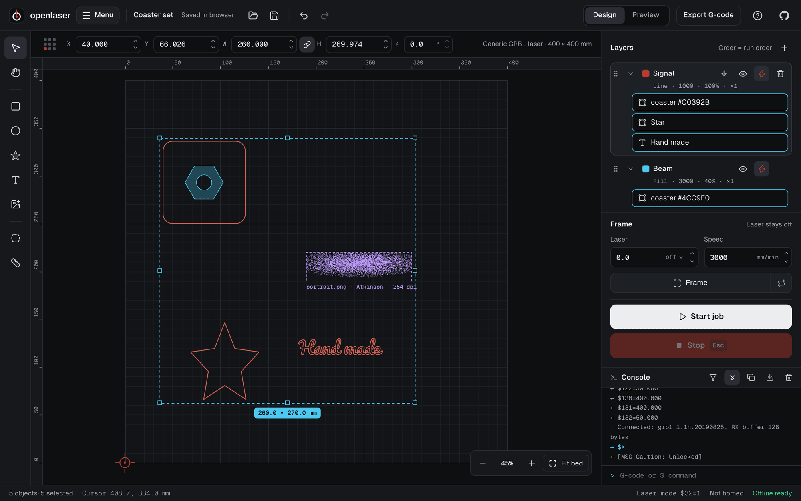
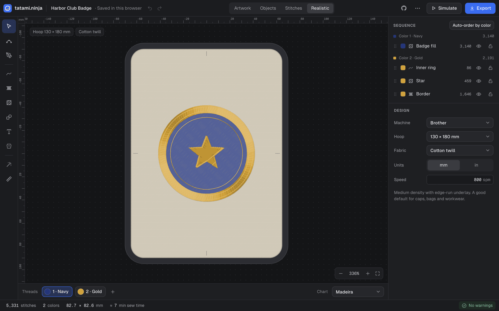
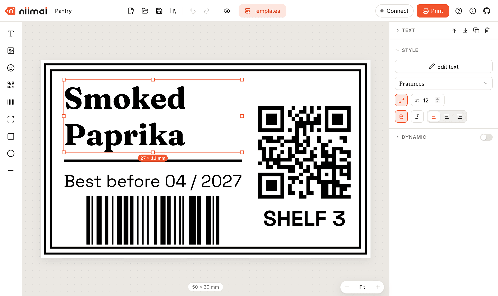
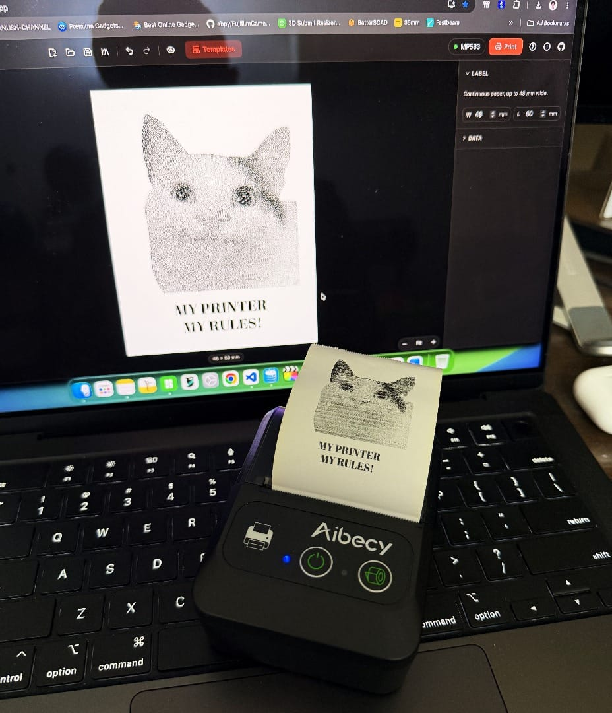

Right off the bat: this is a follow-up to my [previous post about software discrimination](/the-era-of-software-descrimination/). I asserted that at some point people would get pissed off enough to do something about it. And maybe 2026 is the year it happens.

A bit of a recap: hardware that we buy with our hard-earned money is often locked down, downgraded through software, or kept from reaching its full potential just because manufacturers want to sell you the latest hardware. Or they simply stop caring about older hardware. That results in consumers getting a worse experience, early retirement of perfectly fine hardware and, in the end, e-waste.

There are people, unsung heroes, who have been working on different things to solve this exact problem, with or without the help of the manufacturer itself. Funnily enough, if the manufacturer helps, it's called a mod. If the manufacturer does not help, it's a jailbreak. Anyway, we are getting sidetracked here, but the gist of it is: buying these days doesn't always feel like owning. And that's bad.

There has always been a healthy community of hackers and tinkerers working on modding/jailbreaking hardware, especially game consoles, cameras and phones. But that work requires a lot of patience, a lot of probing and countless sleepless nights. Most of it is repetitive work: try something - compile - run - check if it works - repeat. The barrier to entry has always been high. It's expensive, it's risky, and extremely busy people like me often thought it was way out of reach. Now imagine offloading the repetitive part to something that does not sleep and can copy itself thousands of times to try thousands of iterations at once. What you get is nothing short of a revolution. And interestingly, that has started happening.

You might have heard about people [jailbreaking their smart TVs with AI](https://www.youtube.com/watch?v=YtBrjCXQUkg). The basic idea is: you turn on remote debugging over Wi-Fi on your TV, find the TV's IP address and ask your AI coding agent to access the TV and get rid of the bloat. Some people even went one step further and created a completely new launcher with just the apps they want. As a result, their TV runs faster and cooler, and even consumes less electricity and internet bandwidth. Now if you ask me, I would say you SHOULD definitely hack your smart TV, even if only for the sake of your own privacy. It's not a tinfoil-hat conspiracy anymore that your TV is the easiest way to spy on you. Don't believe me? Watch [this video by Gamers Nexus](https://www.youtube.com/watch?v=6IFVTcM28KA). Someone made a GitHub repository with all the tools and instructions necessary to de-bloat your smart TV. You can check it out here: <https://github.com/Gathin23/cleanyourtv>

Let's talk about cameras now. My first DSLR camera was a Canon 1100D. One of the reasons I loved it so much was something called [Magic Lantern](https://www.magiclantern.fm/). Magic Lantern could turn an entry-level Canon camera into a professional beast. I am really glad that Magic Lantern is back in business! And people are also bringing film-like aesthetics to old DSLR and mirrorless cameras with tools like [RecipeLab](https://recipelab.io/) and [Film Roll for Canon](https://florinkiritescu.ro/film-roll-beta11/). Even one of my favourite photography creators, Tony Northrup, [made a video about it](https://www.youtube.com/watch?v=lbtUnjWh1_c). Being an avid Fujifilm user now, I am really happy people are bringing cameras like Canon DSLRs and the Sony NEX series back and preserving the film-like movement. If I still had my 1100D, I would definitely hack the hell out of it.

Let me share something personal now. Last year I bought a laser cutter. It's a 60W diode laser that runs an open source firmware called [grbl](https://github.com/grbl/grbl). But when I checked the disk that came with it, I realised there was no software to control the engraver. The disk came with a trial version of a software called LightBurn. LightBurn is good for what it does, but honestly it leaves a lot to be desired. And when I checked its price, it was $99 per year. If I bought three years' worth of subscription, it would cost more than the hardware itself. Because of that, the laser sat unused in my workshop for almost a year. But I thought to myself: grbl is open source, I know how it works, and I also know the hardware uses a serial interface. What if I try to create a software better than LightBurn for the laser? Pre-agentic coding, it would have taken me years. But with agentic coding, and because I know how it works, it took me months to finish the first version of [Openlaser](https://openlaser.app/). As a bonus, it uses the Web Serial API, so it can be used from the browser without an account, login or payment. And I use it regularly with my laser.

I was showing an early version of Openlaser to my brother-in-law and he asked me: "Can we try something for embroidery digitisation?" This is a very niche industrial technology and only a handful of companies make software for it. Those are sometimes more expensive than the machines themselves, so small business owners have no good alternatives. These machines are sophisticated, but the idea is simple: digital embroidery machines are like printers, but instead of ink, they use thread. My brother-in-law happens to have one for his cap business. If you live in Bangladesh, you might want to check out his caps at <https://caponbd.com>. Now, I did not know much about embroidery at all. But I have worked with similar machines. I knew it has a 2D motion system and technically should use something similar to G-code (I know G-code well because of my 3D printing hobby). I spent four weekends just studying how the digitised files work and reading standards, and finally started building <https://tatami.ninja>. I know the name is a bit cheeky, but people familiar with embroidery know tatami-style stitching very well. It was extremely rewarding when the first generated file was made into an actual cap. A cap that I could wear, generated by a free application I made!

And then a few weeks back, I was trying to label my coffee bean collection. I have a few label makers and thermal printers which I dread using because of their apps. I have two Niimbot label makers and a few Chinese thermal printers. Niimbot machines are good. Really good for the price. But I can't say the same for their app. The app is bad: for anything advanced you wanna do, they ask for extra money (VIP or something). Even a custom font is out of reach. Plus, it can only be used from a phone. It's a very similar situation for the 48mm paper thermal printers. Their apps are even worse: very basic and almost unusable. Previously, I would have sucked it up and done nothing, because I don't have time to tinker with their Bluetooth services and reverse engineer their protocols. But the good people at [NiimBlue](https://github.com/MultiMote/niimblue) had already made a lot of progress, so I did not have to start from scratch. And then <https://niimai.app> was born. Since it already handles most of the bitmap conversion, it was not difficult to add support for mini Bluetooth thermal printers too (even the cute cartoon ones). So now it's an advanced label studio, free for everyone to use.

If you have a thermal printer or Bluetooth label maker, do give it a try. Thanks to [Niimai](https://niimai.app), I can now print my memes on thermal paper with the design I want, in any font I want.

But in all seriousness, if you have capable hardware running shitty software, this might be the best time in history to do something about it. If you know your craft, and know a bit about the technology behind it, maybe owning something can truly mean owning again. Or, if you look around, someone might have already made something that solves your problem too.
